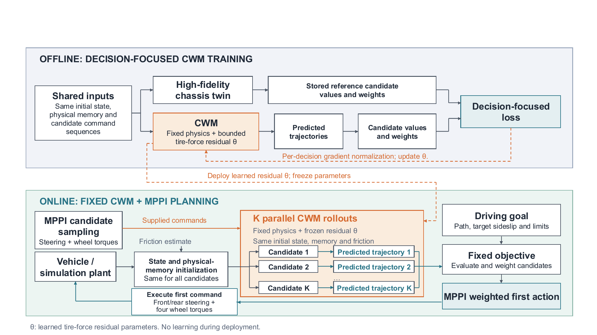
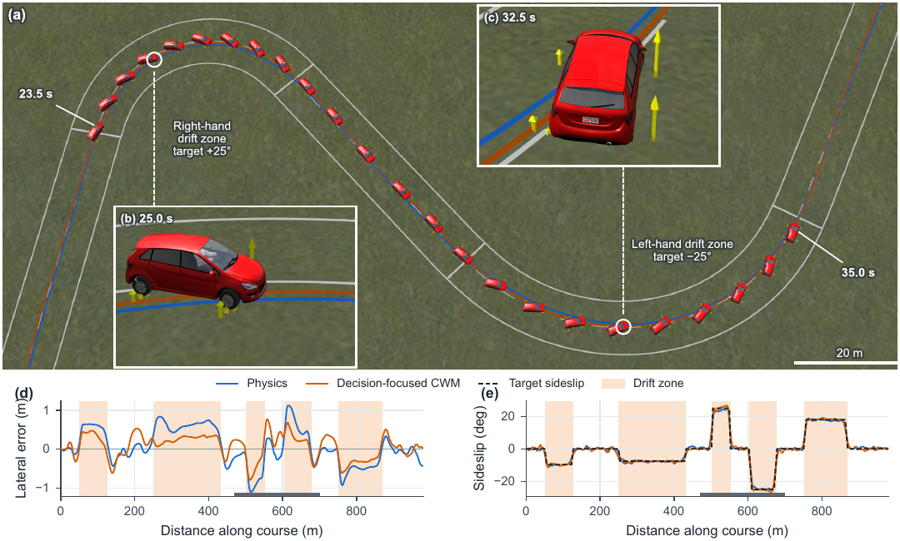

# Physics-Structured Chassis World Models

Dataset and code for **Physics-Structured Chassis World Models with Decision-Focused Tire-Force Learning**, by Dastan Kaldybayev, Yanzhao Su, Jin Huang and Guangyu Tian.

## 1. What this study does

A vehicle planner tests several future steering and wheel-torque commands before choosing its next action. The model used to predict those commands affects which action the planner chooses.

We study a compact chassis model that combines vehicle physics with a small learned correction to each wheel's tire forces. We compare two ways of training the correction: matching recorded vehicle motion, and matching how a higher-fidelity chassis twin evaluates candidate commands. Autonomous drifting provides the control task. The main result is that a model can improve driving precision even when its trajectory predictions become less accurate.

### Learning and planning architecture



The residual is trained offline using the twin's candidate evaluations. Online, the fixed model is used inside MPPI to choose the next command. [Download the diagram as PDF](figures/figure_1.pdf).

## 2. Download the data

The [version 1 dataset release](https://github.com/das1iw/decision-focused-chassis-world-models/releases/tag/v1.0.0) contains three files:

| No. | File | Contents |
|---:|---|---|
| 1 | [Recorded trajectories](https://github.com/das1iw/decision-focused-chassis-world-models/releases/download/v1.0.0/sequence_data_v1.npz) | 256 simulated driving episodes: motion, commands, friction and model memory. |
| 2 | [Planning decisions](https://github.com/das1iw/decision-focused-chassis-world-models/releases/download/v1.0.0/decision_data_v1.npz) | 5,120 situations, each with 64 candidate command sequences and the twin's values. |
| 3 | [CarSim validation logs](https://github.com/das1iw/decision-focused-chassis-world-models/releases/download/v1.0.0/external_baseline_step_logs_v1.zip) | 192 drives comparing physics, an adapted learned-tire model and two decision-trained models. |

Save the first two files in `data/`. Extract the third into `data/carsim/`. See [DATA.md](DATA.md) for array fields, units and train/test splits. Original course and random-seed IDs are retained in the data.

### A recorded CarSim drive



Vehicle paths and lateral-error/sideslip histories for one recorded drive. The example was chosen because complete CarSim outputs were retained for both models. [Download the figure as PDF](figures/figure_2.pdf).

## 3. Code and models

| Folder | Contents |
|---|---|
| `cwm/` | Planar physics, tire-force residuals, the planning objective and rollout kernels. |
| `scripts/` | Training, prediction/decision evaluation, and CarSim-log analysis. All implementation versions start at `v1`. |
| `models/` | Trained checkpoints, numbered from 1; descriptions are in `metadata/models.json`. |
| `config/` | Physical coefficients and training settings. |
| `results/` | Numerical results for the comparisons reported in the paper. |
| `figures/` | The architecture diagram and final CarSim figure from the paper, as PNG and PDF. |

This repository provides the reduced planning model and the training and evaluation code for the released data.

## 4. Getting started

Use Python 3.10 or later:

```text
python -m pip install -r requirements.txt
python scripts/inspect_data_v1.py data/sequence_data_v1.npz
```

Reading the data requires no simulator. Running the physical model requires the licensed vehicle parameter file identified in `metadata/licensed_dependencies.json`. That file supplies the tire and motor tables and is not redistributed. With your own permitted copy:

```text
python scripts/smoke_v1.py --asset-par PATH_TO_VEHICLE_PARAMETER_FILE
python scripts/run_v1.py --asset-par PATH_TO_VEHICLE_PARAMETER_FILE scripts/evaluate_forecasts_v1.py --help
```

The training and evaluation scripts expose their arguments through `--help`. The evaluation code imports CuPy even for CPU evaluation; install a CuPy build matching your CUDA environment before using those scripts. `metadata/environment.json` records the environment used for the package check. Checkpoint loading and model equivalence passed on the recorded environment; a separate-machine/GPU reproduction remains to be completed.

## 5. Scope of the evidence

Training data come from a 44-state simulation twin; the external validation logs come from CarSim. There are no real-vehicle measurements or direct tire-force labels in these files. State initialization and the initial friction prior use simulation information. The learned correction is bounded per axis but is not projected onto a friction circle.

The learned-tire comparison uses our adaptation of the published ExpTanh formulation under the same vehicle and planner. It does not compare the original published controller across its own operating conditions. Courses are the statistical groups; multiple conditions on one course are not independent replications.

## 6. Citation and licenses

Use [CITATION.cff](CITATION.cff) or GitHub's **Cite this repository** button to cite the dataset. The associated paper is named at the top of this page.

Code: [MIT](LICENSE). Data, numerical results, trained checkpoints and figures: [CC BY 4.0](LICENSE-DATA). Native CarSim software and vehicle assets remain under their own terms.
